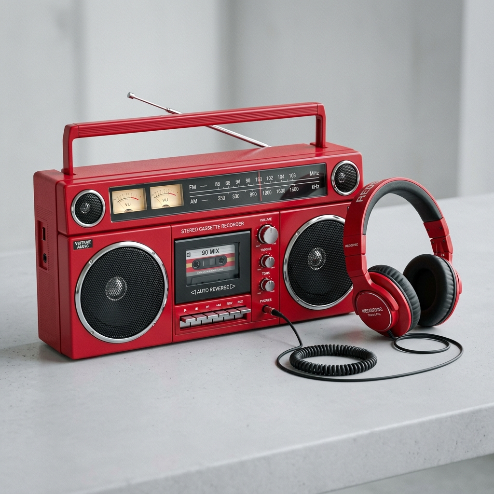

# Music Licensing Platform — Next.js Monorepo for Vercel

A full-stack, production-ready Next.js monorepo built using Turborepo and Tailwind CSS, modeled precisely after the royalty-free music licensing platform reference design.



---

## 🏗 Monorepo Architecture

This workspace is structured as a high-performance **npm workspaces + Turborepo** monorepo designed for effortless deployment to **Vercel**:

```
Caution Studio/
├── package.json               # Root workspaces configuration & Turbo pipelines
├── turbo.json                 # Build & development cache configuration
├── vercel.json                # Vercel deployment descriptor
│
├── packages/
│   ├── types/                 # Shared TypeScript interfaces & types (@caution/types)
│   │   └── src/index.ts       # Track, SubscriptionPlan, Testimonial, FAQItem, User, FilterState
│   │
│   ├── tailwind-config/       # Centralized Tailwind CSS design tokens (@caution/tailwind-config)
│   │   └── tailwind.config.js # Brand luxury monochrome (black & white), shadows, gradients, and keyframes
│   │
│   └── ui/                    # Reusable Tailwind CSS Component Library (@caution/ui)
│       └── src/
│           ├── components/
│           │   ├── Button.tsx               # Primary, outline, secondary, pill variants
│           │   ├── Badge.tsx                # Genre & mood pill badges
│           │   ├── Card.tsx                 # Glass & elevated cards
│           │   ├── Input.tsx                # Styled inputs & SearchInput
│           │   ├── Rating.tsx               # 5-star yellow rating
│           │   ├── Avatar.tsx               # Avatar with initials & status indicator
│           │   ├── Accordion.tsx            # Animated collapsible FAQ items (+ / -)
│           │   ├── Modal.tsx                # Accessible backdrop dialog
│           │   ├── WaveformVisualizer.tsx   # Interactive animated audio waveform
│           │   ├── TrackRow.tsx             # Audio catalog track row with scrubber & actions
│           │   ├── FilterSidebar.tsx        # Left filter sidebar (Mood, Theme, Genre, Instrument)
│           │   ├── AudioPlayer.tsx          # Sticky bottom playback dock with controls & volume
│           │   ├── Navbar.tsx               # Header with logo, links, and 'START FREE NOW' CTA
│           │   ├── Footer.tsx               # Dark mega-footer matching reference design
│           │   ├── HeroSection.tsx          # Floating 3D boombox, clef, and album art compositions
│           │   ├── BrandsRow.tsx            # 5-logo Logoipsum partner bar
│           │   ├── LicensingGrid.tsx        # 18-platform worldwide licensing checklist
│           │   ├── TestimonialsSection.tsx  # Client Testimonials slider
│           │   ├── FAQSection.tsx           # Collapsible FAQ accordion
│           │   ├── CtaBanner.tsx            # 'Join 40,000 creators' bottom banner
│           │   ├── StatsCard.tsx            # Analytics & metric cards
│           │   └── LicenseCertificateModal.tsx # YouTube Content ID clearance certificate
│           ├── utils/
│           │   ├── cn.ts                    # ClassName utility
│           │   └── audioSynth.ts            # Web Audio API real sound generator
│           └── data/
│               └── mockTracks.ts            # Realistic catalog data matching screenshot
│
└── apps/
    ├── web/                   # Port 3000: Marketing & Landing Application
    │   ├── src/app/page.tsx   # Exact reference design recreation with interactive audio playback
    │   ├── src/app/pricing/   # Creator, Pro Commercial, and Studio Enterprise plans
    │   ├── src/app/faq/       # Comprehensive licensing & Content ID FAQs
    │   └── src/app/contact/   # Licensing inquiry & enterprise support
    │
    ├── auth/                  # Port 3001: Authentication Portal
    │   ├── src/app/login/     # Creator & Admin sign-in with demo shortcuts
    │   ├── src/app/register/  # 14-day trial signup with channel clearance input
    │   └── src/app/forgot-password/ # Password recovery flow
    │
    ├── user/                  # Port 3002: Creator Portal & Dashboard
    │   ├── src/app/page.tsx   # Overview, whitelisted channels & recent licenses
    │   ├── src/app/library/   # Full catalog browser with live waveform player
    │   ├── src/app/licenses/  # Downloaded licenses & clearance certificate generator
    │   └── src/app/billing/   # Subscription management & invoice history
    │
    └── admin/                 # Port 3003: Admin & Operations Portal
        ├── src/app/page.tsx   # MRR, total streams, and active creator telemetry
        ├── src/app/tracks/    # Catalog manager with audio upload modal & tagging
        ├── src/app/licenses/  # YouTube Content ID claims resolver
        └── src/app/users/     # Creator subscribers list & role manager
```

---

## 🚀 Getting Started

### 1. Install Dependencies
Run `npm install` from the root directory:
```bash
npm install
```

### 2. Development Servers
You can run any individual application or all of them together:

| Application | Command | Local URL |
| :--- | :--- | :--- |
| **Marketing (Web)** | `npm run dev:web` | [http://localhost:3000](http://localhost:3000) |
| **Auth Portal** | `npm run dev:auth` | [http://localhost:3001](http://localhost:3001) |
| **User Creator App** | `npm run dev:user` | [http://localhost:3002](http://localhost:3002) |
| **Admin Control** | `npm run dev:admin` | [http://localhost:3003](http://localhost:3003) |
| **All Apps Concurrently** | `npm run dev` | Turborepo boots all 4 apps |

### 3. Production Build
Verify compilation of all packages and apps:
```bash
npm run build
```

---

## 🎨 Design & Components Highlights

1. **Faithful Visual Recreation**:
   - **Hero Section**: Exact typography (*"Get royalty free music for your videos"*), electric royal blue pill buttons, floating vintage red boombox with headphones, 3D golden treble clef, neon EDM artwork, and subtle ambient blur backlights.
   - **Brands Bar**: 5 geometric Logoipsum partner emblems.
   - **Licensing Grid**: 18 video platforms (YouTube, TikTok, Twitch, Cinema, Commercials, Weddings, etc.) with blue checkmarks.
   - **Music Catalog Table**: Filterable by Mood, Video Theme, Genre, and Instrument.
   - **Real Interactive Audio**: Powered by `WebAudioSynth`, clicking Play on any track synthesizes rich melodic chord loops, animates the waveform scrubber, and launches the persistent bottom `AudioPlayer` dock!
   - **Client Testimonials**: 5-star ratings, author avatars, and carousel controls.
   - **Collapsible FAQ**: Expandable items with item #3 (*"How do the plans work and what do they cover?"*) matching the reference.
   - **Dark Mega Footer**: Complete with products, licensing terms, copyright, and social icons.

2. **Component Reusability (`@caution/ui`)**:
   - Every button, input, badge, table, modal, and player component is defined once in `packages/ui` and imported across all 4 applications.
   - Zero duplication of styling or UI logic.

---

## ☁️ Deploying to Vercel

### Option A: 4 Separate Vercel Projects (Recommended)
Create 4 projects in the Vercel Dashboard pointing to this Git repository:
1. **Web Project**: Set **Root Directory** to `apps/web`.
2. **Auth Project**: Set **Root Directory** to `apps/auth`.
3. **User Project**: Set **Root Directory** to `apps/user`.
4. **Admin Project**: Set **Root Directory** to `apps/admin`.

Vercel automatically detects Next.js and utilizes the root workspace cache.

### Option B: Monorepo Micro-Frontends (Multi-Zones / Rewrites)
Use Next.js rewrites in `apps/web/next.config.mjs` to proxy subpaths:
- `/auth/:path*` ➔ `https://auth.yourdomain.com/:path*`
- `/app/:path*` ➔ `https://user.yourdomain.com/:path*`
- `/admin/:path*` ➔ `https://admin.yourdomain.com/:path*`

---

## 📜 License
Private & Proprietary — Created for Caution Studio.
